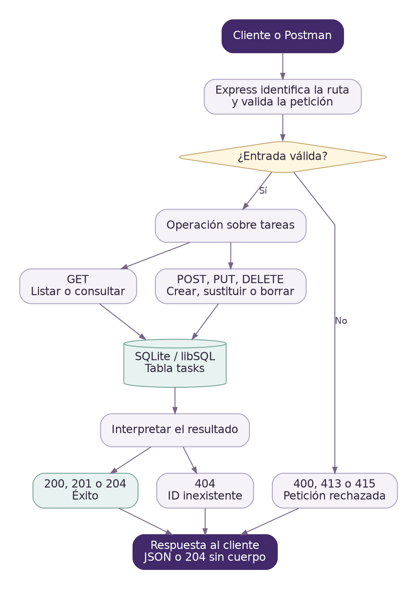

# API de gestión de tareas

Proyecto final del módulo de backend · Opción 1

La API guarda tareas con título, descripción, fecha límite y estado. El servidor usa Node.js 24 y Express 5. Los datos se conservan en SQLite durante el desarrollo y en una base libSQL remota de Turso durante el despliegue.

## Ejecutar en local

1. Descomprime el proyecto y abre en VS Code la carpeta que contiene `package.json`.
2. En **Terminal → Nueva terminal**, ejecuta estos comandos con Node.js 24 instalado:

   ```bash
   npm ci
   npm test
   npm start
   ```

3. Abre <http://localhost:3000/tasks>. Si todavía no hay tareas, verás `[]`. Mantén la terminal abierta mientras utilizas Postman. Pulsa Ctrl+C para parar el servidor.

La API crea la tabla la primera vez que se utiliza. En local, el archivo `tareas.db` conserva las tareas entre reinicios. No hacen falta cuentas externas para trabajar en local.

## Rutas

| Método | Ruta | Operación | Éxito |
| --- | --- | --- | --- |
| POST | /tasks | Crear una tarea | 201 |
| GET | /tasks | Listar todas las tareas | 200 |
| GET | /tasks/:id | Consultar una tarea | 200 |
| PUT | /tasks/:id | Sustituir los datos de una tarea | 200 |
| DELETE | /tasks/:id | Eliminar una tarea | 204 |

La [referencia de la API](docs/API.md) define los campos, los valores iniciales, los errores y ejemplos de petición y respuesta.

## Diagrama de flujo



Express valida cada petición antes de acceder a la tabla. Las operaciones de lectura consultan los datos y las de escritura los modifican. El servidor transforma el resultado en la respuesta HTTP que recibe el cliente.

## Pruebas unitarias y Postman

Las pruebas de Jest están en [tests/tasks.test.js](tests/tasks.test.js). Aíslan la lógica de las tareas mediante un repositorio simulado. La colección de Postman comprueba el recorrido completo por HTTP y el almacenamiento real.

1. Arranca la API con `npm start`.
2. En Postman, abre **Import** y selecciona [Tareas.postman_collection.json](postman/Tareas.postman_collection.json).
3. Abre la colección y elige **Run collection**. Ejecuta las 16 peticiones en el orden guardado. La primera guarda el ID generado y la última comprueba que el borrado surtió efecto.
4. Para comprobar Vercel, cambia la variable de colección `baseUrl` a la URL de producción, sin barra final y sin `/tasks`. Guarda y repite la ejecución.

La colección crea y borra su propia tarea de ejemplo. La [verificación local](docs/Verificacion.md) recoge los estados HTTP y resultados observados.

## Publicar en GitHub y desplegar en Vercel

1. Crea un repositorio en GitHub y sube el **contenido** de esta carpeta. Comprueba que `package.json`, `app.js`, `package-lock.json` y `vercel.json` estén en la raíz. Incluye también `src`, `tests`, `docs`, `postman` y `.gitignore`. La persona que corrija la entrega debe poder abrir el repositorio.
2. Crea una base **libSQL** en Turso y obtén su URL y un token de base de datos con permisos de lectura y escritura. Desde la CLI de Turso, una vez iniciada la sesión:

   ```bash
   turso db create proyecto-tareas
   turso db show proyecto-tareas --url
   turso db tokens create proyecto-tareas
   ```

   Si eliges otro nombre de base de datos, úsalo en los tres comandos.
3. En Vercel, crea un proyecto e importa el repositorio de GitHub. Usa la carpeta que contiene `package.json` como **Root Directory**. El proyecto ya declara Express y Node.js 24.
4. Antes de desplegar, configura las variables de entorno en **Production**. Si vas a probar despliegues de vista previa, configura también **Preview**:

   | Variable | Valor |
   | --- | --- |
   | TURSO_DATABASE_URL | URL real de la base libSQL creada en Turso |
   | TURSO_AUTH_TOKEN | Token de lectura y escritura de esa base |

   Guarda el token únicamente en las variables de entorno. Si cambias una variable después de desplegar, crea un nuevo despliegue.
5. Pulsa **Deploy**. Abre la dirección de producción acabada en `/tasks` en una ventana privada. Debe devolver una lista JSON sin pedir inicio de sesión. Repite la colección de Postman con esa dirección base y comprueba el resultado.
6. En el documento Word de entrega, pega el enlace real al repositorio y el enlace público a `/tasks`. Guarda en formato **.doc** y adjunta ese documento a la sección del ejercicio en la plataforma.

Documentación oficial: [Express en Vercel](https://vercel.com/docs/frameworks/backend/express) · [Crear una base en Turso](https://docs.turso.tech/quickstart) · [Cliente libSQL](https://docs.turso.tech/sdk/ts/reference).
